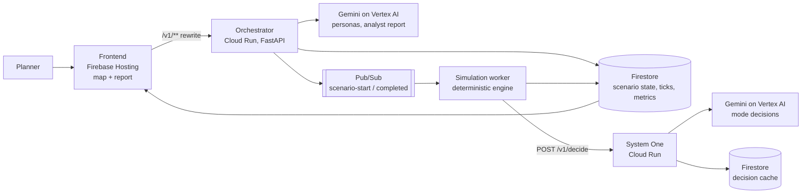

# Shadow City

**Test a city policy on AI residents before real residents live with it.**

Shadow City is a city-policy simulator for Jakarta. A synthetic population of AI residents, each with a home, a workplace, an income, vehicles and habits, decides how to commute under a policy such as a central parking tariff increase or an event such as a North Jakarta tidal flood. A deterministic simulation engine computes travel times, costs and flooding; Gemini makes and explains the decisions. Planners compare a policy scenario against a baseline and see who gains and who loses, down to each kelurahan and income band.

- **Live prototype:** https://shadow-city.web.app
- **Theme:** Sustainability & Social Impact (Google Cloud AI Builder Cup 2026)
- **Built on:** Gemini on Vertex AI, Cloud Run, Firebase Hosting, Firestore, Pub/Sub, Cloud Build

## The problem

Jakarta regularly debates transport policies, for example parking tariffs and transit fares, and faces tidal flooding in its northern districts. These decisions are usually made without a way to test, before rollout, how they change residents' daily commutes, and which neighbourhoods or income groups carry the cost.

## What Shadow City does

1. **Generate a population.** Each resident gets a deterministic skeleton (home and work kelurahan, age, income band) drawn from the scenario's seed, and Gemini fills in a behavioural profile: occupation, vehicles, usual mode, departure time, and how sensitive they are to cost and time.
2. **Simulate a weekday.** The engine runs 204 ticks of 5 simulated minutes (05:00–22:00). For every resident it computes each available mode's travel time, cost and flood exposure.
3. **Decide.** Each resident's choice is a structured question to the decision service (System One): the engine's numbers plus the resident's profile, habits and memory in, a probability per mode and a short reason out. The chosen mode is sampled from those probabilities with a seeded random generator.
4. **Compare.** A policy scenario runs against a baseline with the same seed and population. Differences per kelurahan, per income band and citywide are computed by code.
5. **Explain.** An analyst agent (Gemini) turns those precomputed differences into a short report: headline, winners, losers, recommendations and caveats.

The map shows residents moving tick by tick, coloured by mode, with the parking zone and flood area overlaid, next to the analyst report.

## Design principles

- **LLMs decide and explain; code computes.** Travel times, costs, capacity, flooding and every difference between scenarios come from deterministic code. Gemini never produces a physical number, and the report may only quote numbers it was given.
- **Reproducible.** Every scenario has a seed. Identical decision requests are served from a decision cache, so re-running a scenario replays identical decisions at no model cost.
- **Honest reports.** Without a baseline, the report describes outcomes and states that they cannot be attributed to the policy. With a baseline that does not share the same population and seed, it says so.
- **Every decision has evidence.** Each decision is logged with its full input, option probabilities, chosen option, model, token usage and cost.

## Architecture



| Component | Technology | Role |
| --- | --- | --- |
| Frontend | Next.js, Firebase Hosting | Map of Jakarta, resident animation, scenario selection, analyst report |
| Orchestrator | Python, FastAPI on Cloud Run | Scenarios, population generation, comparison, analyst report |
| System One | Python, FastAPI on Cloud Run | Per-resident decisions with structured output, decision cache, BigQuery log |
| Gemma | Ollama on Cloud Run with an NVIDIA L4 (Singapore) | Gemma 4 / Gemma 3 behind the same System One API |
| Simulation worker | Python | Deterministic engine: ticks, routes, travel time, cost, flooding |
| State | Firestore (named database `shadow-city`) | Scenarios, personas, ticks, metrics, reports, decision records, decision cache |
| Analytics | BigQuery (`shadow_city`) | Every decision with inputs, probabilities, model, tokens and cost |
| Events | Pub/Sub | `scenario-start`, `scenario-completed`, `scenario-failed` |
| CI | Cloud Build | Tests on every merge request and on `main` |

The interface between the AI/backend track and the simulation/frontend track is a written contract: [`docs/CONTRACT.md`](docs/CONTRACT.md).

## What is built, and what is next

| Area | Status |
| --- | --- |
| Population generation with Gemini, seeded skeletons over all 262 mainland Jakarta kelurahan (OpenStreetMap) | Live |
| Mode decisions by Gemini with habit context, structured output, deterministic sampling, fallbacks | Live |
| Decision cache: identical requests replay identically, no model call | Live |
| Simulation engine, live map from Firestore | Live |
| Baseline vs policy comparison (`/v1/scenarios/{id}/compare`) and analyst report | Live |
| Token usage and cost per decision, per scenario | Live |
| Evidence chain: click a resident to see options, probabilities, choice and reason | Live |
| Decision log in BigQuery (`shadow_city.decisions`, every decision with full evidence) | Live |
| Verifier agent: code-decided checks against a cited BPS reference, Gemini audit of persona coherence | Live |
| Gemma 4 (e2b, e4b) and Gemma 3 4B on a Cloud Run L4 GPU, behind the same System One API | Live (demo uses Gemini) |
| Distil Gemini into Gemma with the logged teacher decisions | Next |
| Persona clustering and parallel workers for thousands of residents | Next |
| Backtest against a real event (Jakarta's Rp1 transit fare day) | Next |

## Cost

Measured on 2026-10-17 with `gemini-3.8-flash` at its introductory Vertex AI price:

| Item | Tokens | Cost (USD) |
| --- | --- | --- |
| One mode decision | ~1,080 | ~0.0023 |
| Population of 50 residents | 8,418 | 0.022 |
| Replayed (cached) decision | 0 | 0 |

`infra/cost_report.py <scenario_id>` totals a scenario's Gemini cost from Cloud Logging.

Two ways to cut it, both measured on logged decisions (details in [`ml/distillation/README.md`](ml/distillation/README.md)):

- **Gemini thinking level `low`:** −65% per decision ($0.0020 → $0.0007), same favourite option in 87% of 100 decisions, against 93% when Gemini is simply asked again. Available as `GEMINI_THINKING_LEVEL=low`.
- **Gemma as System One:** live on a Cloud Run L4 GPU. Untuned, it returns valid structured output 100% of the time and picks Gemini's favourite in 50–63% of 150 decisions (Gemini's favourite is in Gemma's top two 75–83%). Distillation on the 4,228 logged Gemini decisions is the next step.

## Limitations

- **Synthetic population; directional results only.** Homes are spread uniformly over kelurahan because official population counts per kelurahan are not yet integrated. Age, income and workplace distributions are placeholders, marked `TODO` in the code.
- **Engine assumptions** (station catchment, walking speed, waiting times) are model assumptions, not measured values.
- **Gemini is not bit-for-bit deterministic.** Reproducibility comes from the decision cache, not from the model.

## Repository

```
shadow-city/
├── docs/CONTRACT.md        # interface between the two tracks (schemas, APIs, Firestore, Pub/Sub)
├── docs/REFERENCE.md       # design reference and roadmap
├── services/orchestrator/  # scenarios, population, comparison, analyst report
├── services/system-one/    # /v1/decide: Gemini decisions, decision cache
├── services/sim-worker/    # deterministic simulation engine
├── services/gemma/         # Gemma on a Cloud Run L4 GPU (Ollama)
├── ml/distillation/        # Gemma vs Gemini agreement, thinking-level experiment
├── frontend/               # map web app (Firebase Hosting)
├── data/zones.geojson      # parking zone and flood area polygons
├── ci/                     # Cloud Build test pipeline
└── infra/                  # deploy, Pub/Sub, CI and cost scripts
```

Each service has its own README with local run and deploy steps. Deployment: `infra/deploy.sh` (see [`infra/README.md`](infra/README.md)).

## Run locally

```bash
cd services/system-one      # or services/orchestrator
uv venv --python 3.12 && uv pip install -r requirements-dev.txt
.venv/bin/python -m pytest
.venv/bin/uvicorn app.main:app --reload --port 8080
```

## Data and licences

- Kelurahan centroids and boundaries: © OpenStreetMap contributors, Open Database License (ODbL).
- Residents and their decisions are synthetic, generated by Gemini; no personal data is used.

## Team

EBCO Cloud Expert
