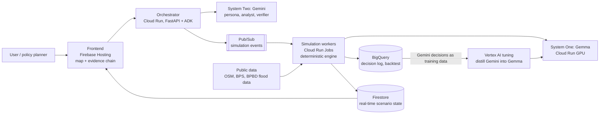

# Shadow City — Development Reference

**As of:** 2026-10-17
**Companion file:** `docs/CONTRACT.md` (integration contract between tracks)

## 1. Summary

Shadow City is a city-policy simulator: thousands of AI residents move across a map of Jakarta and react to policies (transit fares, parking tariffs) and events (floods), so planners can compare "what if" scenarios in minutes.

- **Competition:** Google Cloud AI Builder Cup 2026 (JAPAC, run by Hack2skill).
- **Theme:** Sustainability & Social Impact.
- **Main demo question:** "If central parking tariffs rise and Transjakarta fares are adjusted, who is affected most, and do residents actually switch to public transport? What if a tidal flood hits North Jakarta at the same time?"
- **Team goal:** learn as many new technology concepts as possible inside one coherent solution. Winning is not the main target.

**Key design decisions:**

1. Simulate **behavior** (mode choice, route, departure time), not opinions.
2. **Gemini = System Two** (planning, analysis, reports). **Gemma = System One** (fast per-agent decisions).
3. A **deterministic simulation engine** computes routes, travel times, and capacity. LLMs never compute physical numbers.
4. Every agent decision has a clickable **evidence chain**.
5. Simulation results are **backtested** against real Jakarta data.

## 2. Competition requirements

All of these must be met before submission ([Challenges & Requirements](https://aibuildercup.com/themes.html)).

- [ ] Uses Google AI models (Gemini or Gemma) or a Google agentic platform
- [ ] Functional prototype deployed on Google Cloud via Cloud Run or Firebase
- [ ] Proposal deck as PDF: problem, impact, feasibility, scalability, GCP architecture slide
- [ ] Public 3-minute demo video (YouTube, Vimeo, or public Google Drive)
- [ ] Official theme stated clearly: Sustainability & Social Impact
- [ ] All materials (code, docs, deck, video) in English
- [ ] Team of 2–4, all working professionals (no students)

**Judging weights:** Technical Merit & Gen AI 40%, Problem Alignment & Impact 25%, Innovation & Creativity 25%, User Experience & Solution Design 10%.

## 3. Differentiation and lessons from past winners

A similar concept, [Sim Francisco](https://claude.com/blog/meet-the-winners-of-our-claude-opus-4-8-build-day-hackathon), took 2nd place at the Claude Opus 4.8 Build Day (June 2026). That validates the concept, but Shadow City must be clearly different.

| Aspect | Sim Francisco | Shadow City |
| --- | --- | --- |
| What is simulated | Opinions (election polling) | Behavior over time (mode, route, timing) |
| Context | San Francisco elections | Jakarta transport policy and flooding |
| Cost saver | Clustering into ~300 personas | Clustering + Gemma as System One |
| Computation | LLM answers | LLM decides, deterministic engine computes |

**Winner patterns to adopt:**

- **Backtest against real data.** Sim Francisco stood out because its forecasts were close to actual results.
- **Evidence chain.** 1st-place Tekton shows the source and reasoning behind every clicked component.
- **Separate verifier agent** that grades results in its own context window.
- **AI for interpretation, deterministic code for computation,** with constrained outputs ([OpenAI Build Week analysis](https://www.remio.ai/post/openai-build-week-winners-show-what-codex-can-build-beyond-demos)).
- **A measurable cost-saving story** (Sim Francisco cut inference cost 10–100×).
- **Reserve dedicated time for the demo video;** it always takes longer than expected.

## 4. Architecture

The Cloud Run orchestrator splits the work: Gemini for planning and analysis, Gemma for fast decisions, and the deterministic engine for all computation.

Simulation workers also write per-tick state to Firestore, so the map in the frontend moves in real time.

## 5. Tech stack

All components run on Google Cloud in project **`ebc-cloud-dev-03`** (the only project used for Shadow City); check model versions and regional availability during setup.

| Component | Technology | Role |
| --- | --- | --- |
| Frontend | Next.js/React + Google Maps JS API (or deck.gl over the map) | City map, agent animation, scenario panel, evidence chain |
| Frontend hosting | Firebase Hosting | Serves the web app |
| API & orchestration | Cloud Run (Python, FastAPI) + Google ADK | Scenario endpoints, orchestrator, analyst and verifier agents |
| System Two | Gemini (latest Pro/Flash) via Vertex AI | Generate personas, plan scenarios, analyze results, write policy reports |
| System One | Gemma (small size) on Cloud Run GPU | Fast decisions per agent per simulation step |
| Fine-tuning | Vertex AI (Gemma tuning) | Distill Gemini decisions into Gemma |
| Simulation engine | Python (NetworkX/OSMnx for the road graph) on Cloud Run Jobs | Compute routes, travel times, capacity, flooding per tick |
| Event bus | Pub/Sub | Stream simulation events and trigger workers |
| Storage | Firestore (scenario state, real-time to UI) + BigQuery (decision log, results, backtest) | State and analytics |
| Geospatial | BigQuery GIS, OpenStreetMap | Flood zones, distances, aggregation per kelurahan |
| Observability | Cloud Logging + Cloud Trace | Track latency and cost per scenario |
| Build tools | Antigravity / Claude Code / AI Studio | Speed up coding and prompt experiments |

## 6. Core technical design

These eight concepts are the core of the learning goal; each has a clear role in one simulation flow.

### 6.1 Generative agents (persona + memory)

- Gemini generates a synthetic population from demographic distributions per kelurahan: age, occupation, income, home and work locations, vehicles, cost and time sensitivity.
- Each agent has short memory (yesterday's traffic jam or flood) that influences its next decisions.

### 6.2 System One / System Two

- **System Two (Gemini):** called rarely. Plans personas' daily schedules, interprets new policies, analyzes results.
- **System One (Gemma):** called very often. Answers closed questions per agent, e.g. "choose a mode: motorcycle, car, Transjakarta, KRL, ojol" with probabilities.
- System One output is always structured (JSON choices + scores), never free text.

### 6.3 Teacher–student distillation

1. Gemini (teacher) answers thousands of sample decision situations; answers are stored in BigQuery.
2. That data is used to tune Gemma (student).
3. Measure Gemma–Gemini agreement on a held-out test set; target high agreement at a much lower cost per decision.

### 6.4 Deterministic simulation engine

- Time advances in ticks (5 simulated minutes per tick).
- Road graph and routes from OpenStreetMap; travel time computed from congestion, mode capacity, and flood zones.
- Fixed random seed, so the same scenario always yields the same result and scenarios are comparable.

### 6.5 Persona clustering

- Group residents with similar profiles into representative personas; one decision is shared by the cluster's members with small variation.
- Record cost before and after clustering as part of the cost-saving story.

### 6.6 Counterfactual reasoning

- Run the baseline and the policy scenario with the same seed.
- Compare per kelurahan and per income band: travel time, cost, mode shift.
- The analyst agent (Gemini) writes a policy summary: who benefits, who loses, alternative recommendations.

### 6.7 Evidence chain

- Every decision is stored with its reasoning: profile, conditions at the time (tariffs, flooding, travel times), option probabilities, and which model decided.
- In the UI, click an agent to see its chain of decisions.

### 6.8 Verifier and backtest

- **Verifier agent** (Gemini, separate context) checks whether population distributions and mode shares are plausible against reference statistics.
- **Backtest:** run a scenario that actually happened (for example the Rp1 special-fare day) and compare the direction of change with reported ridership data.

## 7. Data schemas

The authoritative schemas live in `docs/CONTRACT.md`. Summary of the three core objects:

- **Persona** — profile, home/work location, vehicles, sensitivities, short memory (contract §2.1).
- **Decision** — System One request with engine-computed options, and response with probabilities, chosen option, short reason, and `decided_by` (contract §2.3).
- **Scenario** — seed, population size, policies, events, status, progress (contract §2.2).

All numbers in examples are format illustrations only, not data.

## 8. Data sources

Start with open and synthetic data; the status column marks what still needs checking.

| Data | Source | Used for | Status |
| --- | --- | --- | --- |
| Road network | OpenStreetMap (via OSMnx) | Route graph and travel times | Available |
| Population per kelurahan | BPS / Jakarta Dalam Angka | Synthetic persona distribution | Check latest format |
| Public transport routes and stops | Jakarta open data / GTFS if available | Mode and route options | Check availability |
| Flood and inundation data | BPBD DKI flood monitoring page | Flood zones for scenarios | Check access |
| Public transport ridership | Jakarta government releases and news | Backtest direction of change | Available as aggregates from news |
| Sample personas and decisions | Generated by Gemini | Population and distillation data | Self-generated |

Policy context for scenarios: ITDP's fare and subsidy modeling ([Investortrust](https://investortrust.id/business/111904/itdp-perbarui-model-transportasi-jabodetabek-untuk-hitung-tarif-dan-subsidi)), the parking tariff evaluation ([source](https://achmadnurhidayat.id/pemprov-dki-evaluasi-tarif-parkir)), and potential tidal flooding in North Jakarta ([MerahPutih](https://www.merahputih.com/post/read/banjir-rob-jakarta-oktober-2026)).

## 9. Layered development roadmap

Each layer produces a running version; the next layer adds one new concept.

1. **Layer 0 — Foundation.** GCP project, Cloud Run "hello world", Firebase Hosting, repo, simple CI.
    - Done when: a public URL shows an empty map of Jakarta.
2. **Layer 1 — Gemini-only MVP.** 50 personas from Gemini, one scenario, mode decisions made directly by Gemini, simple engine (straight-line distance, no road graph).
    - Done when: resident dots move on the map and a result summary appears.
3. **Layer 2 — Real simulation engine.** OSM road graph, ticks, mode capacity, fixed seed.
    - Done when: the same scenario gives identical results twice.
4. **Layer 3 — Counterfactual + report.** Baseline vs policy scenario, comparison per kelurahan, analyst agent writes the report.
    - Done when: the UI shows two scenarios side by side with the report.
5. **Layer 4 — Evidence chain + verifier.** Decision log to BigQuery, click-an-agent panel, verifier agent checks distributions.
    - Done when: every agent is clickable and the verifier returns a pass/fail report.
6. **Layer 5 — System One + distillation.** Collect Gemini decision data, tune Gemma, deploy on Cloud Run GPU, route routine decisions to Gemma.
    - Done when: Gemma–Gemini agreement is measured and cost per simulation drops.
7. **Layer 6 — Scale + clustering.** Thousands of agents, persona clustering, Pub/Sub for parallel workers.
    - Done when: a simulation with thousands of agents finishes in minutes.
8. **Layer 7 — Flooding + backtest.** Flood zones from BPBD data, backtest scenario against real data.
    - Done when: a backtest panel compares simulation vs data.
9. **Layer 8 — Submission polish.** UX, PDF deck, 3-minute video, English documentation.

If time is short, layers 0–3 are enough for a submittable prototype; later layers become follow-up development.

## 10. Demo scenario and 3-minute video script

The video follows 30 seconds of problem, 2 minutes of demo, 30 seconds of scalability; narration in English.

| Time | On screen | Key message |
| --- | --- | --- |
| 0:00–0:30 | News clips: ITDP fare study, parking tariff debate, tidal flooding | City policies are decided without a tool to test their impact on residents |
| 0:30–0:50 | Jakarta map, thousands of resident dots moving (baseline) | These are AI residents, each with their own profile and needs |
| 0:50–1:20 | Choose a policy: central parking tariff up; run | Mode shift is visible directly on the map |
| 1:20–1:45 | Add a North Jakarta tidal flood | Layered impact: who gets stuck, who is hit hardest |
| 1:45–2:10 | Click one resident: evidence chain | Every decision can be explained, not a black box |
| 2:10–2:30 | Analyst report + backtest panel | Results are tested against real data |
| 2:30–3:00 | Architecture diagram, Gemini-to-Gemma cost savings | Scalable to other JAPAC cities |

Tip: record each segment separately and stitch them; keep pre-run scenario results as a fallback if the live demo is slow.

## 11. Risks and mitigations

| Risk | Mitigation |
| --- | --- |
| Too complex to finish | Build layer by layer; layers 0–3 are already submittable |
| Simulation accuracy questioned | Position as a scenario-exploration tool; verifier + backtest; state limitations honestly |
| API costs grow | Persona clustering, Gemma as System One, cap agents per scenario, monitor cost in Cloud Logging |
| Public data hard to access | Start with synthetic data matched to aggregate statistics |
| Cloud Run GPU or Gemma tuning blocked by quota | Fallback: Gemini Flash-Lite with structured output as System One |
| Similar to Sim Francisco | Emphasize behavior simulation, Jakarta context, System One, deterministic engine |
| Live demo slow or failing | Keep pre-run scenario results; record the video from stored results |

## 12. Sources

- [AI Builder Cup 2026 – Challenges & Requirements](https://aibuildercup.com/themes.html)
- [Claude Opus 4.8 Build Day winners (Sim Francisco, Tekton)](https://claude.com/blog/meet-the-winners-of-our-claude-opus-4-8-build-day-hackathon)
- [OpenAI Build Week winners – remio](https://www.remio.ai/post/openai-build-week-winners-show-what-codex-can-build-beyond-demos)
- [ITDP updates Jabodetabek transport model – Investortrust](https://investortrust.id/business/111904/itdp-perbarui-model-transportasi-jabodetabek-untuk-hitung-tarif-dan-subsidi)
- [Jakarta evaluates parking tariffs](https://achmadnurhidayat.id/pemprov-dki-evaluasi-tarif-parkir)
- [North Jakarta tidal flooding, October 2026 – MerahPutih](https://www.merahputih.com/post/read/banjir-rob-jakarta-oktober-2026)
- [Jev and the System One pattern – X](https://x.com/i/trending/2105154696566501872)
